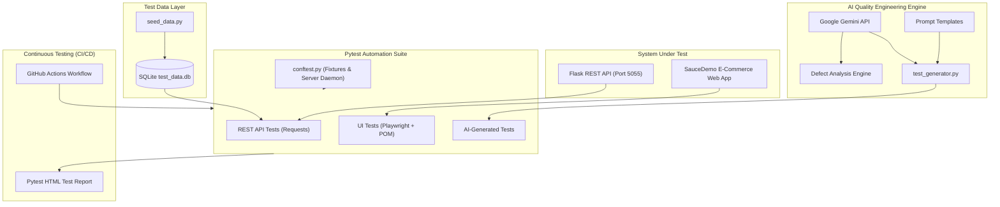

# 🧪 AI-Augmented Test Automation Framework

[](https://github.com/AtharvaKanade/AI_based_QA/actions)


A production-grade, AI-augmented Quality Engineering and SDET framework developed to demonstrate modern test automation, REST API validation, Page Object Model (POM) UI testing, SQL test data management, and GenAI-driven test case generation.

Built to align with the **Capgemini Exceller Program (Graduate Test Automation / SDET / AI Engineer)** requirements.

---

## 🏛️ Architecture Overview



---

## 🚀 Key Highlights & Capabilities

### 1. 🤖 AI-Driven Quality Engineering
- **User Story to Test Automation**: Generates executable Pytest test cases directly from Agile user stories using Google Gemini API.
- **AI Defect Root Cause Analysis**: Evaluates execution failure stack traces, assigns priority/severity, and recommends fixes.
- **Offline Fallback Engine**: Works seamlessly with or without an active API key using deterministic fallback synthesis.

### 2. 🎭 Modern UI Automation (Playwright)
- Implements the **Page Object Model (POM)** pattern (`BasePage`, `LoginPage`, `InventoryPage`, `CheckoutPage`).
- Tests real-world e-commerce flows (Authentication, Sorting, Cart updates, and E2E Checkout).
- Uses auto-waiting locators and web-first assertions for zero-flakiness.

### 3. 🔌 REST API Testing & Security Boundaries
- Full contract, CRUD, and boundary testing against a custom Flask E-Commerce API.
- **Role-Based Access Control (RBAC)** validation (`Admin` vs `Customer` bearer tokens).
- Query parameter filtering (`category`, `max_price`) and edge case assertions (400, 401, 403, 404).

### 4. 🗄️ SQL Test Data Management
- SQLite database (`test_data.db`) seeded with deterministic test fixtures.
- Sourcing parameterized test cases dynamically via parameterized SQL queries.

### 5. 🔄 Continuous Testing (CI/CD)
- Fully automated **GitHub Actions** workflow (`ci.yml`).
- Automatic environment configuration, browser dependency installation, DB seeding, test execution, and **HTML test report** artifact publishing.

---

## 📂 Repository Structure

```
AI-QA-Framework/
├── .github/
│   └── workflows/
│       └── ci.yml                  # GitHub Actions CI/CD Pipeline
├── app/
│   └── sample_api/
│       └── app.py                  # System Under Test (Flask REST API)
├── conftest.py                 # Root Pytest fixtures, test server, report setup
├── data/
│   ├── seed_data.py                # Database schema, seeding & SQL queries
│   └── test_data.db                # SQLite test database
├── tests/
│   ├── api/                        # REST API Test Suites
│   │   ├── test_users_api.py
│   │   └── test_products_api.py
│   └── ui/                         # Playwright UI Test Suites (POM)
│       ├── pages/
│       │   ├── base_page.py
│       │   ├── login_page.py
│       │   ├── inventory_page.py
│       │   └── checkout_page.py
│       ├── test_login.py
│       ├── test_inventory.py
│       └── test_checkout.py
├── ai_engine/
│   ├── test_generator.py           # Gemini AI test generator & defect analyzer
│   ├── prompts/
│   │   ├── user_story_prompt.txt   # Prompt template for test generation
│   │   └── defect_analysis_prompt.txt # Prompt template for defect triage
│   └── generated/
│       └── test_ai_demo.py         # AI-generated automated test suite
├── reports/                        # HTML test execution reports
├── pytest.ini                      # Pytest configurations and markers
├── requirements.txt                # Project dependencies
├── TESTING_STRATEGY.md             # Formal QA Strategy & Architecture Doc
└── README.md                       # Documentation & Portfolio Guide
```

---

## ⚡ Quick Start Guide

### 1. Prerequisites
- Python 3.10+ (Tested on Python 3.11 & 3.13)
- Git

### 2. Clone and Setup Environment
```bash
git clone https://github.com/AtharvaKanade/AI_based_QA.git
cd AI_based_QA

# Create virtual environment
python -m venv venv
# Windows:
venv\Scripts\activate
# Linux/macOS:
source venv/bin/activate

# Install dependencies
pip install -r requirements.txt

# Install Playwright browser binaries
playwright install chromium
```

### 3. Initialize SQLite Database
```bash
python data/seed_data.py
```

### 4. Run Tests

**Run all tests (UI + API + AI-Generated) with HTML Report:**
```bash
pytest
```
*The HTML test report is automatically saved to `reports/report.html`.*

**Run only REST API tests:**
```bash
pytest -m api
```

**Run only Playwright UI tests:**
```bash
pytest -m ui
```

**Run smoke tests only:**
```bash
pytest -m smoke
```

---

## 🤖 Using the AI Test Generator

Set your Gemini API key (optional — fallback mode operates without it):
```bash
# Windows PowerShell:
$env:GEMINI_API_KEY="your-gemini-api-key"
# Linux/macOS:
export GEMINI_API_KEY="your-gemini-api-key"
```

### Generate Tests from a Custom User Story:
```bash
python ai_engine/test_generator.py --story "As a customer, I want to search products under $15 so that I stay within my budget."
```

### Run AI Defect Analysis:
```bash
python ai_engine/test_generator.py --defect-log path/to/failed_log.txt
```

---

## 📊 Sample Test Report

The framework automatically outputs an interactive, self-contained HTML report via `pytest-html`:
- Execution timestamp and duration
- Environment metadata (OS, Python version, Capgemini SDET project tags)
- Granular breakdown of Passed, Failed, and Skipped assertions
- Stack trace inspection for failed runs

---

## 🎯 Capgemini JD Mapping Matrix

| Capgemini Exceller JD Requirement | Framework Implementation |
|---|---|
| **Knowledge of Python** | Built 100% in modern Python 3 with clean type annotations and PEP 8 standards |
| **Develop & maintain automation test scripts** | Playwright UI tests + Pytest Requests API tests |
| **Leveraging AI & GenAI tools** | `ai_engine/test_generator.py` integrated with Google Gemini API |
| **Using AI to generate test cases & scripts** | Automatic translation of User Stories into Pytest suites |
| **Prompt Engineering skills** | Tailored system prompts in `ai_engine/prompts/` |
| **Familiarity with databases & SQL queries** | SQLite schema design, database seeding, and data-driven parameterized tests |
| **Support continuous testing within CI/CD pipelines** | GitHub Actions workflow (`.github/workflows/ci.yml`) |
| **Support defect analysis & reporting** | `analyze_defect()` LLM triage + HTML test reporting |
| **Awareness of Cloud & DevOps** | Container-ready, headless CI execution, automated artifacts |

---

## 📝 Resume Bullet Points (Ready to Copy)

- **AI-Augmented QA & SDET Framework (Python, Playwright, Pytest, Gemini AI, GitHub Actions)**
  - Engineered an end-to-end automated testing framework covering REST API contract testing and UI regression suites with Playwright using the Page Object Model (POM).
  - Integrated Google Gemini API to build an AI-driven test generator that translates Agile user stories into executable Pytest scripts, cutting manual scripting time.
  - Implemented data-driven testing leveraging SQLite database fixtures to validate complex business logic and Role-Based Access Control (RBAC).
  - Designed and deployed a GitHub Actions CI/CD continuous testing pipeline that automatically executes test suites and publishes interactive HTML test reports on each push.

---

## 📜 License
Distributed under the MIT License.

